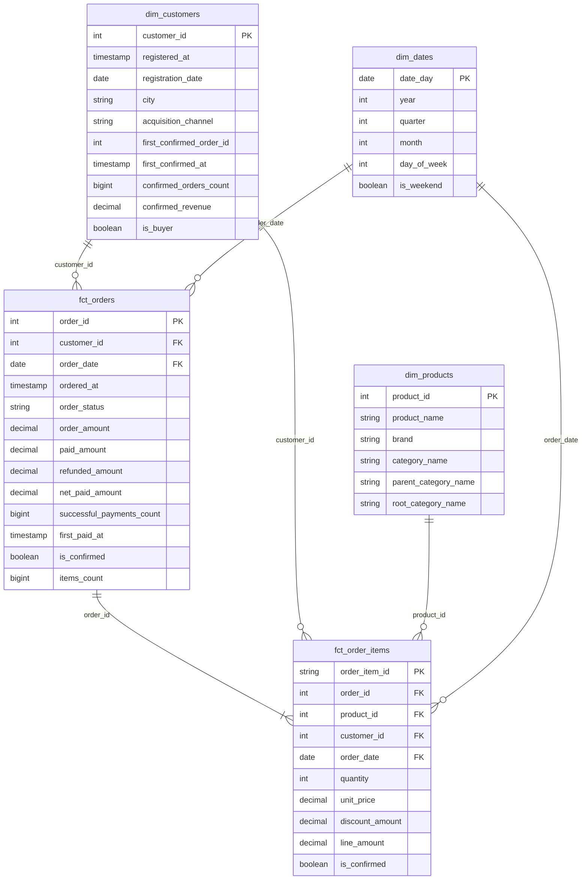
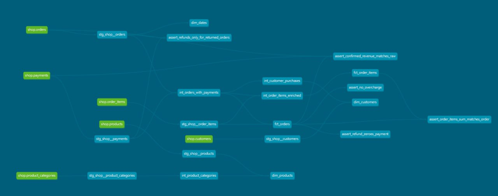

# Аналитические витрины интернет-магазина

## Назначение

Проект формирует аналитический слой интернет-магазина в Greenplum с помощью dbt. Данные проходят через четыре уровня:

- `raw` — копия таблиц OLTP-базы, загружаемая сервисом `loader`.
- `analytics_staging` — представления `stg_shop__*` с приведением названий и простыми вычисляемыми полями.
- `analytics_intermediate` — представления `int_*` с платёжными итогами, позициями заказов с контекстом и иерархией категорий.
- `analytics_marts` — таблицы фактов и измерений для аналитических запросов.

## Модель данных

Витрины построены по схеме «звезда». Центральные таблицы фактов — `fct_orders` и `fct_order_items`; измерения — `dim_customers`, `dim_products` и `dim_dates`.

### ER-диаграмма

Связи фактов с измерениями показаны по ключам соединения. Один заказ содержит одну или несколько товарных позиций; ключ позиции — пара `(order_id, product_id)`.



### Граф lineage в dbt Docs



На скриншоте показаны источники, модели staging и intermediate, витрины и бизнес-тесты. Интерактивный граф доступен после выполнения `dbt docs generate` и запуска `dbt docs serve`.

### Зерно и назначение витрин

| Витрина | Зерно | Бизнес-вопрос |
|---|---|---|
| `fct_orders` | Одна строка на нетестовый заказ | Сколько заказов оформлено, какова их сумма и сколько заказов подтверждено оплатой? |
| `fct_order_items` | Одна строка на товар в нетестовом заказе | Какие товары, бренды и категории формируют продажи и выручку после скидок? |
| `dim_customers` | Одна строка на клиента, включая клиентов без покупок | Как отличаются покупатели по каналам привлечения, городу и выручке? |
| `dim_products` | Одна строка на товар | Как распределяется выручка по товарам, брендам и уровням категорий? |
| `dim_dates` | Одна строка на календарный день | Как меняются заказы и продажи по дням, месяцам, кварталам и дням недели? |

### Хранение в Greenplum

| Витрина | Настройка | Обоснование |
|---|---|---|
| `fct_orders` | `DISTRIBUTED BY (order_id)`, `orientation='column'` | Факт распределён по ключу заказа, как `raw.orders`. Колоночное хранение подходит для аналитических запросов, читающих отдельные поля. |
| `fct_order_items` | `DISTRIBUTED BY (order_id)`, `orientation='column'` | Используется тот же ключ распределения, что и у `fct_orders` и `raw.order_items`; соединение позиций с заказом по `order_id` не требует перераспределения строк. |
| `dim_customers` | `DISTRIBUTED REPLICATED` | Небольшой справочник копируется на сегменты, поэтому соединение с фактами не требует пересылки строк измерения. |
| `dim_products` | `DISTRIBUTED REPLICATED` | Справочник товаров доступен на каждом сегменте для локального соединения с фактами. |
| `dim_dates` | `DISTRIBUTED REPLICATED` | Календарь невелик и копируется на сегменты для локального соединения по дате. |

Обе таблицы фактов распределяются по `order_id`. Если распределить их по разным ключам, Greenplum может потребоваться перераспределить строки при соединении фактов по заказу. Измерения небольшого размера хранятся с репликацией.

## Правило подтверждения покупки

Покупка считается подтверждённой, если заказ имеет статус `paid` и по нему есть хотя бы одна успешная платёжная операция, не являющаяся возвратом. Возвраты представлены успешными операциями с отрицательной суммой. В промежуточной модели оплаты и возвраты агрегируются отдельно.

## Заказ 113 и предупреждение о переплате

Тест `assert_no_overcharge` имеет уровень `warn`. В данных у заказа 113 сумма заказа равна 200, но зафиксированы два успешных списания по 200. Сумма списаний составляет 400, то есть на 200 больше стоимости заказа. Тест показывает эту запись как предупреждение; данные не изменяются и предупреждение не отключается.

## Запуск проекта

Команды выполняются из корня проекта. После запуска контейнеров дождитесь завершения загрузки raw-таблиц, затем установите пакет `dbt_utils` и только после этого собирайте модели.

```bash
# Пересоздать учебные базы и запустить сервисы

docker compose down -v
docker compose up -d

# Дождаться завершения загрузки raw

docker compose logs -f loader

# Установить зависимости из packages.yml

docker compose run --rm dbt deps

# Проверить подключение и собрать модели вместе с тестами

docker compose run --rm dbt debug
docker compose run --rm dbt build

# Сформировать и открыть документацию

docker compose run --rm dbt docs generate
docker compose run --rm --service-ports dbt docs serve --host 0.0.0.0 --port 8080 --no-browser
```

После запуска сервера документации откройте `http://localhost:8080`. Команду `dbt deps` нужно выполнить после чистого запуска до `dbt build`: она устанавливает `dbt_utils`, используемый в модели `dim_dates`.

## Проверка результатов

Количество строк в витринах:

```sql
select 'fct_orders' as model_name, count(*) as row_count
from analytics_marts.fct_orders
union all
select 'fct_order_items', count(*)
from analytics_marts.fct_order_items
union all
select 'dim_customers', count(*)
from analytics_marts.dim_customers
union all
select 'dim_products', count(*)
from analytics_marts.dim_products
union all
select 'dim_dates', count(*)
from analytics_marts.dim_dates;
```

Ожидаемые значения на учебных данных:

| Витрина | Строк |
|---|---:|
| `fct_orders` | 135 |
| `fct_order_items` | 425 |
| `dim_customers` | 40 |
| `dim_products` | 13 |
| `dim_dates` | 133 |

Дополнительные проверки:

- Подтверждённых заказов — 106, сумма — 91 620,00.
- Сумма `line_amount` по подтверждённым позициям — 91 620,00.
- В `dim_customers` — 29 покупателей и 11 клиентов без покупок.
- У клиента 1 первая подтверждённая покупка — заказ 101; всего 9 покупок на 7 280,00.
- У клиента 40 `is_buyer = false`, `first_confirmed_at = NULL`.
- Категория товара 11 (`Pot A`): `Home > Kitchen > Cookware`.
- Категория товара 12 (`Case B`): `Electronics > Accessories > Cases`.
- Выручка по корневым категориям: `Electronics` — 59 994,28; `Home` — 31 625,72.
- Календарь охватывает период с 2026-03-01 по 2026-07-11 включительно. Его границы вычисляются по всем заказам в `stg_shop__orders`, в том числе тестовым.
- `assert_no_overcharge` должен показать предупреждение по заказу 113.

Для проверки распределения таблиц в Greenplum:

```sql
select
    c.relname,
    pg_get_table_distributedby(c.oid) as distribution,
    am.amname as storage
from pg_class c
join pg_namespace n on n.oid = c.relnamespace
left join pg_am am on am.oid = c.relam
where n.nspname = 'analytics_marts'
  and c.relkind = 'r';
```
